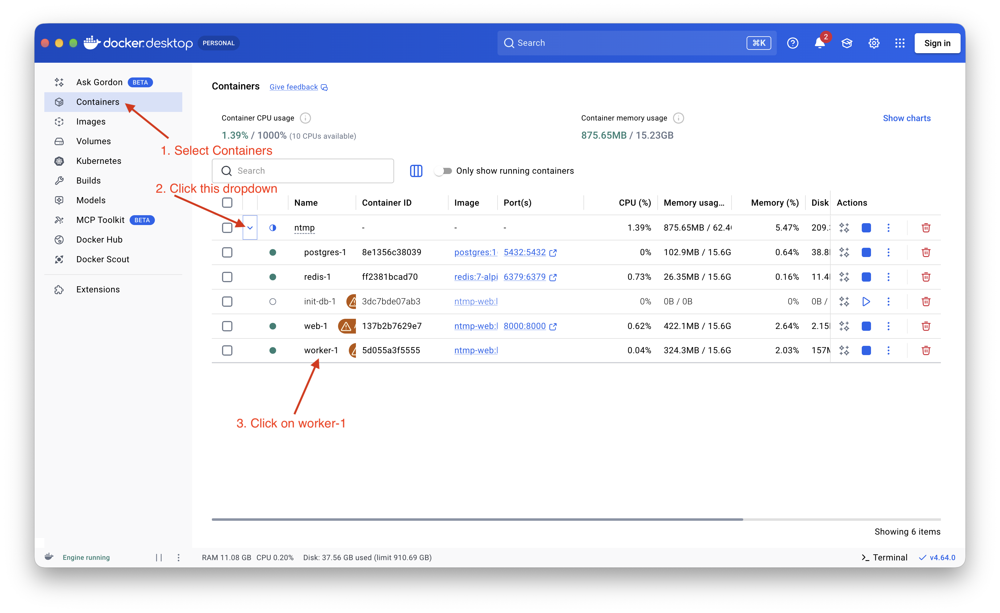
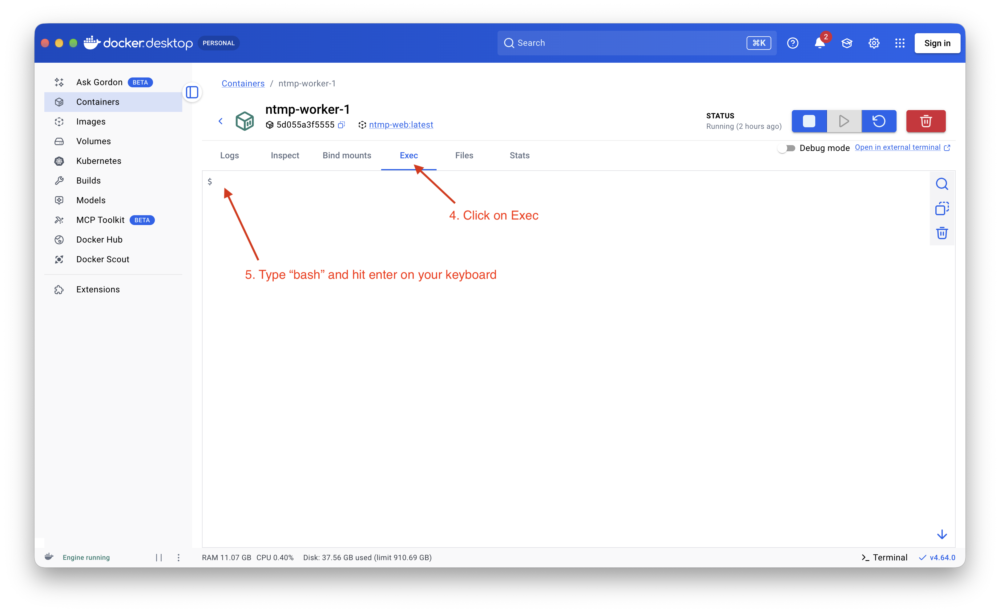
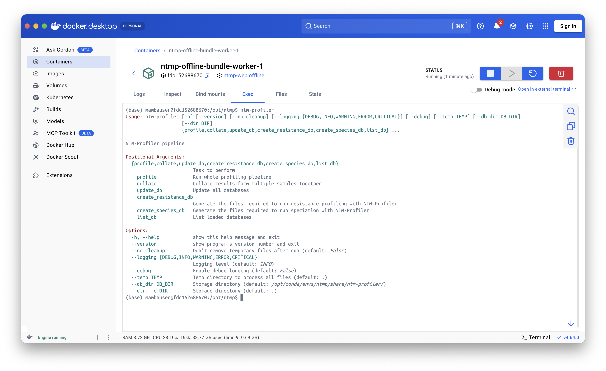

# Using the CLI 

## Using docker to access the command line

NTM-Profiler is a python-based tool and can be run using its command-line interface (CLI). When you upload a file to the webserver it gets processed using this tool and the results are then displayed to your browser. There are some situations where you may want to use the CLI instead of the webserver:

1. When you have a lot of data to process. You can use commands to automate the process of running ntm-profiler and collecting the results.
2. Accessing more advanced features of ntm-profiler such as consensus genome creation and modifying the filtering criteria.

The CLI can only run on Linux and macOS systems so we have used docker to make it run on windows. Docker allows you to run a virtual linux system. It also makes installation easy as we can create an "image" with all the software pre-installed. 

We can also use docker to access the CLI. These steps are explained below (note: the screenshots may differ as I made them on a mac)

1. Open up your docker desktop application and click on **_Containers_** on the left side of the window. 
2. Click on the dropdown button to display all the running containers
3. Click on the **_Worker-1_** container



4. CLick on the **_Exec_** tab
5. Type in `bash` into the main window and hit enter on your keyboard



You now have access to the command line. I'll refer to this as the **_terminal_** from now on.

## Accessing the files

1. On your file explorer copy in the example data into the **_mount_** folder. You may also put any other data you want to analyse. Please **copy** the data as it is very easy to accidentaly delete data when using the terminal
2. On the terminal type in `cd /data/mount`. This will change your active directory on the linux container to where you have made the data available
3. Type in `ls` to check if you can see your files


## Using ntm-profiler CLI

### Running the CLI

As you probably noticed, you need to write commands on the terminal to use command line tools. To use ntm-profiler the command is `ntm-profiler`. Type it in and check the output of the terminal. 



By default if you run the tool without any arguments it will print a small help text and exit. You should notice that ntm-profiler has many subfunctions that you can use. The most important one is `profile`, this is the function used to process sequence data to a report.

Let's try running it on some data. First we will create a folder to store our results:

```
cd /data/mount/ntm-ngs-data/ntm-course/
mkdir analysis
cd analysis
```

The first command moved to the `/data/mount/ntm-ngs-data/ntm-course/` folder and the second command create a new folder called `analysis`. Finally, we moved into the new folder.

We can then run the following command:

```
ntm-profiler profile -1 /data/mount/ntm-ngs-data/ntm-course/fastq/SAMEA2071452_1.fastq.gz -2 /data/mount/ntm-ngs-data/ntm-course/fastq/SAMEA2071452_2.fastq.gz -p SAMEA2071452 -t 4
```

The pattern is `ntm-profiler profile` followed by a series of arguments:

1. `-1` points to the forward reads fastq file. This can be a relative or absolute path
2. `-2` points to the reverse reads fastq file
3. `-p` argument sets the prefix for all output files 
4. `-t` sets the number of threads that can be used for the analysis. Most modern machines can use multiple so we've set it to 4
5. `--txt` tells the software to produce a text report in addition to the json format report

!!! hint
    The tool usually runs for a few minutes. If you notice it finishing in a few seconds it probably has not executed correctly. The first thing to do is check for typos in your command. Note: the terminal is case sensitive so make sure you have typed our the arguments exactly as they are written in the command above.


### Checking the output

Let's have a look at the text output. To do this you can run the following command to print the output of the file to the terminal.

```
cat SAMEA2071452.results.txt
```

!!! question
    Compare these results to what you found with the webserver. Do you see any differences?

You can also access the results via the file explorer on your system. Open up the **_mount_** folder and then navigate to the ntm-ngs-data -> ntm-course -> analysis subfolders. You should be able to see the results and open on your native system.

!!! task
    Try to run it on sample **_SAMEA2275882_** using the command above as a template. Hint: just swap out _SAMEA2071452_ for _SAMEA2275882_


### Combining results across multiple runs

Quite often we have multiple samples and would like to summarise the results. You can use the `collate` function for this. Try running the following command in the terminal:

```
ntm-profiler collate
```

After a few seconds it will finish running and you should have two files available:
1. ntmprofiler.collate.txt - this contains a summary on the sample level (e.g. species)
2. ntmprofiler.collate.txt.variants.csv - this contains a list of all variants found across your samples.

Try to open these by using one of the previously described methods.

!!! question
    * Which resistance mutations are present across all your samples?