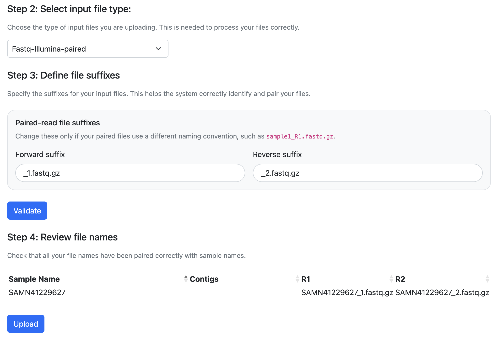
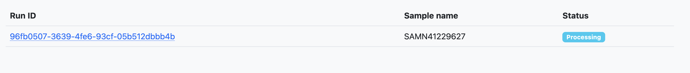
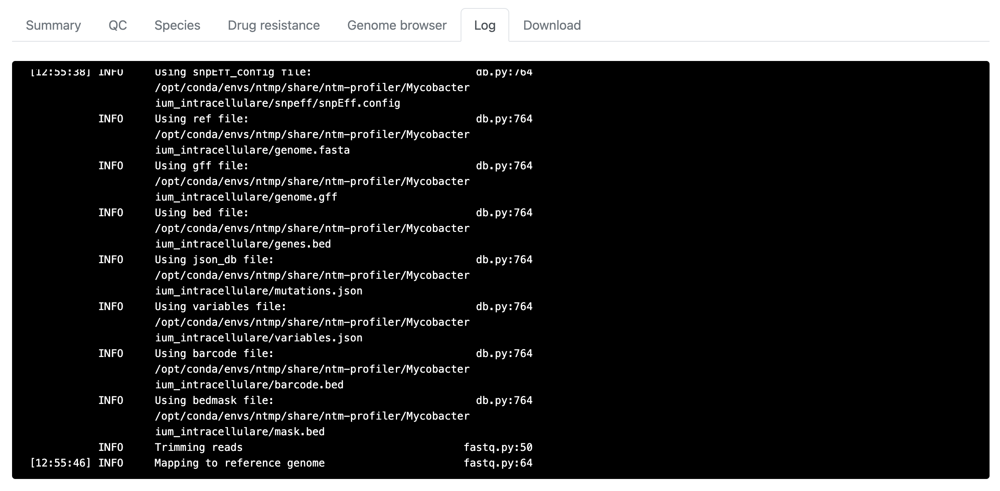
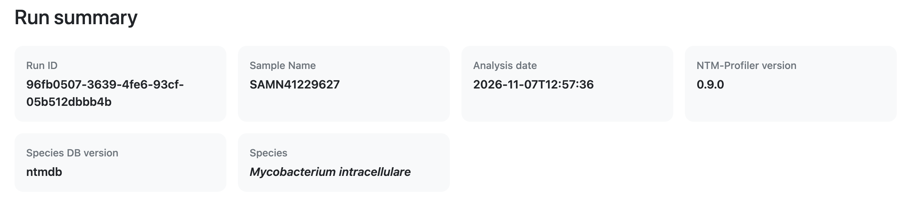
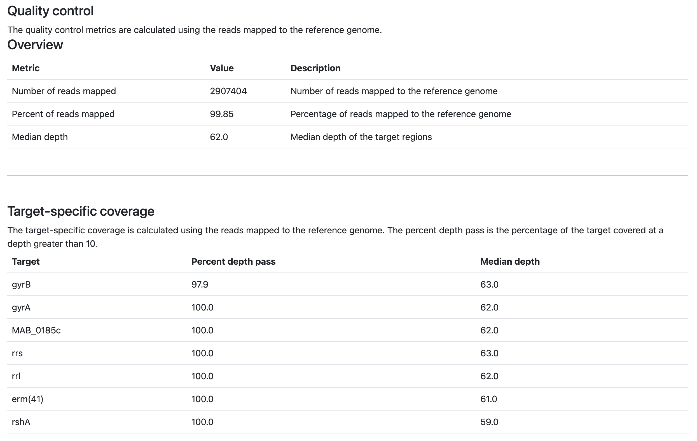
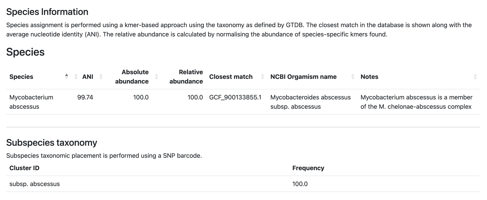
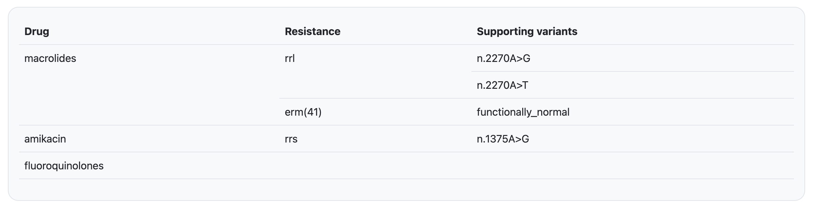
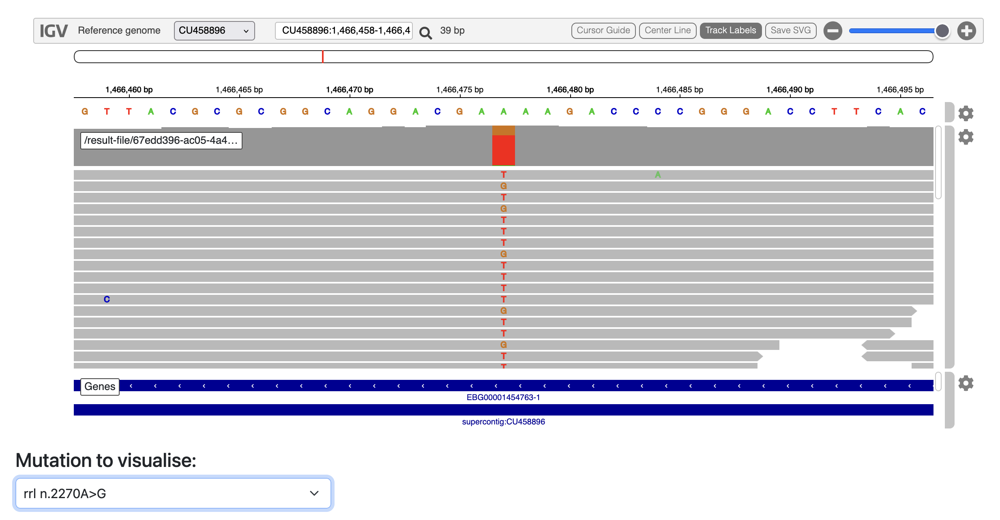

# NTM-Profiler webserver

## Examples

Open up the ntm-profiler website and we will now run through some examples that will allow you to interpret the results it produces. 

### Uploading data

To demonstrate how to upload data, we will use the sample SAMEA2071452. 

1. First click on the **_Upload_** button on the navigation bar on the top of the screen. 

2. Click on the box which says **_Drop FASTQ files here to upload_**. This will open up a browser where you can select your files

3. Find the fastq files for SAMEA2071452. Remember, this is paired Illumina sequencing so there will be two files you need to upload. They should end with _1.fastq.gz and _2.fastq.gz. Once you have selected them, click **_Open_**.

4. Select the type of data you have in the dropdown menu. We are uploading paired illumina data.

5. Make sure the file endings match with what your files have. Different instruments will produce slightly different namings. For example if your files were `SAMEA2071452_R1.fastq.gz` and `SAMEA2071452_R2.fastq.gz`, then you should input `_R1.fastq.gz` and `_R2.fastq.gz`.

6. Click validate and then check that the files have been correctly matches. In this case you should see a table with one row. You should see it has automatically extracted the sample name as `SAMEA2071452` and matches this to the correct forward and reverse read files. If you had any mistakes or files which could not be added to a sample it will indicate with a warning and you can change the settings and try to validate again.

7. Once you are happy with the validation, click **_Upload_** and the files will start to upload.

8. When the upload is complete you will be taken to a new page which will show the runs you have uploaded.

9. The data will start processing now, if you want you can click on the **_Run ID_** link and this will take you to the results page for that sample.

10. While it is still processing you will be able to see some of the commandline output.

11. Once it is done it will automatically refresh and show you your results.

### Interpreting the results

The results are divided into multiple tabs. 

#### Summary 

The first tab will show you a summary of your data.

It will show you the:
1. Run ID
2. Sample name
3. Date of completion
4. Version of ntm-profiler used
5. Name of the species database used
6. The predicted species

In this case the software has predicted **_Mycobacterium abscessus_**. 

!!! Note
    Species prediction is performed using the taxonomic nomenclature published by the Genome Taxonomy Database (GTDB). This uses the single Mycobacterium genus for all species and differs in this respect from the NCBI taxonomy scheme which splits it up into five different genus.

#### QC

The next tab will show you some quality control metrics. This will differ depending on what data you uploaded (fastq vs fasta). 

The overview section will show you

1. Number of reads mapped - Higher numbers will lead to better coverage of potential resistance loci.
2. Percent of reads mapped -  The closer the value is to 100% the more of your data has been aligned to the reference genome. Low percentages could mean potential contamination or a strain which differs significantly from the reference sequence. 
3. Median depth - This is the median depth of the reads across the reference genome. E.g. a median depth of 30x means on average each position is covered by 30 reads. Higher values will give you more confidence on detecting mutations. Generally 30x coverage is sufficient to detect mutations and genes of interest.

The target-specific coverage will show you for each resistance-associated gene the percentage which is covered sufficiently (defualt = 10x) and the median depth for that gene. Low values in both columns could indicate lack of data or a potential partial or full deletion of the gene.

#### Species

The species tab will show you information about the species and subspecies assignments. Species assignment is performed using a kmer-based approach using the taxonomy as defined by GTDB. The closest match in the database is shown along with the average nucleotide identity (ANI). The relative abundance is calculated by normalising the abundance of species-specific kmers found. 

For each species the following is shown:

1. The species name
2. The ANI with the match in the databse
3. The absolute abundance 
4. The relative abundance - when only one species is present this will be 100% but if you have a mixture this will approximate to the proportion of that species in the mixture
5. The accession of the closest match in the database
6. The NCBI organism name of the closest match (note this is input by the uploader and may differ from the GTDB assignment)
7. Notes - any noteworthy information such as complex membership will be stated here

If a subspecies taxonomy scheme is available it will also show here. In this example _M. abscessus_ can be further classified into subspecies abscessus, bolletii or massiliense. This is performed using a list of single nucleotide polymorphisms that are specific to these subspecies. You may also have mixtures of multiple subspecies here.

For each taxonomic unit it will show the ID and the frequency (100% for single strain).

#### Resistance

As mentioned above, resistance is driven by acquisition of mutations or the presence of resistance genes. This tab will show you if it has found any of these. A full list of mutations that ntm-profiler looks for can be found at [the NTM-DB website](https://pathogen-profiler.github.io/ntm-db/)

The first summary table will show a row for each drug together with the any resistance variants found in the associated resistance genes. In this example we should be able to see three different mutations (two in rrl and one in rrs) and the presence of a functionally normal erm(41) gene which confers resistance to macrolides.

!!! question
    You may notice that the same position is represented twice in rrl. Why do you think this is?

These results are further described in the subsequent tables. For drug resistant variants extra information incldues:
1. Position - this is the position of the mutation in the reference genome
2. Type - the functional consequence of the mutation e.g. missense or a non-coding variant (in rRNA)
3. Fraction - the proportion of the reads supporting a variant (values between 0 and 1). Values less than 1 could indicate a minority variant due to a subpopulation with the mutation (i.e. heteroresistance)
4. E. coli monenclature - mutations may somtimes be refered to based on position of the mutation in E. coli

NTM-Profiler does not only analyse drug resistant variants, variants are detected across the whole gene of interest and so may capture other mutations which are not associated with resistance or a novel resistance variant that is not present in the database. Similar information is shows as described above.

!!! question
    How many missense mutations can you identify? Which genes are they in?

#### Genome browser

The alignments of the reads across resistance genes is stored and can be browser on the next tab.

The dropdown menu can be used to center on a specific mutation. Individual reads are represented by the grey segments. Differences from the reference sequences are highlighted with the allele shown in a different colour. You can zoom in and out and scroll around by clicking and dragging on the main area.

!!! question
    Try to navigate to _rrl_ n.2270A>G. What do you observe?

#### Log

This contains the log output from ntm-profiler. Not super interesting unless something goes wrong during processing.

#### Download

Different files are available to download. The results are available as text and json files. In addition, if a reference genome was available for your species, it will display the BAM file which contains the alignments of the reads, along wiht the index for for the bam and the reference genome files. These can be used to visualise in IGV or for custom downstream processing.

## More examples

### Fasta input

Locate the assembly file in fasta format and upload this using the same method as above. You will need to change the input file type to **_Fasta assembly_**.
When using fasta as input, the data will processed in a different way. These differences are explained below.

#### QC

As we no longer have reads, the QC page will now only display:

1. The number of reads - this is actually the number of contigs in your assembly. More contigs means a more fragmented assembly, so fewer is better. 
2. Number of bases - this should roughly equate to the genome size of your organism. If it is significantly less it may indicate that you have not captured the full genome. If it is significantly more then it could indicate the presence of contamination.

#### Species

As assebmly essentially uses all the reads to produce one sequence, we lose abundance information. It is still displayed here but should be used for interpretation when using fasta as input.

#### Drug resistance

As mentioned above, abundance information is removed. This also means minority variants will **not be detected**. 

!!! question
    Can you see any difference in this page from when you used fasta?

#### Genome browser

The genone browser is not available for fasta input.

## Summary

You should now be comfortable with uploading data and interpreting the results. Try to upload some of the other samples and see what you find.

